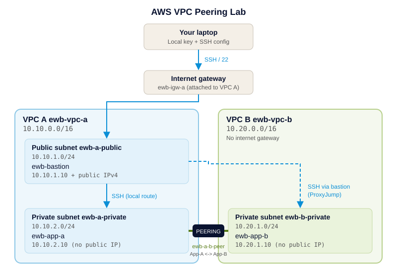

# AWS VPC Peering Lab


Connect two private VPCs with VPC peering and prove private connectivity using
a bastion host, explicit route tables and tightly scoped security groups.
Built manually in the console first, then codified in Terraform.

> Based on the EWB Courses "AWS VPC Peering" student project workbook.

## Architecture

```
Laptop --SSH--> Internet Gateway --> [VPC A 10.10.0.0/16]          [VPC B 10.20.0.0/16]
                                      public  10.10.1.0/24 bastion   (no IGW)
                                      private 10.10.2.0/24 App-A <--pcx--> private 10.20.1.0/24 App-B
```

Administration: laptop > bastion > App-A / App-B (SSH ProxyJump).
Project traffic: App-A <-> App-B over private IPs through the peering connection.



## Key design points

- VPC CIDRs must not overlap (`10.10.0.0/16` vs `10.20.0.0/16`).
- Peering alone is not enough: routes are needed on **both** sides.
- The bastion's public subnet also needs the `10.20.0.0/16` peering route, because ProxyJump makes the bastion open the connection to App-B. The more specific route wins over `0.0.0.0/0`.
- App-B's SSH rule allows the bastion's **private** IP, since that is the source App-B sees.
- Peering is one-to-one and non-transitive; VPC B gets no internet access through VPC A.
- Private instances have no public IP and no NAT gateway is used.

Full tables: [docs/address-plan.md](docs/address-plan.md). Tests: [docs/test-plan.md](docs/test-plan.md).

## Option 1: Manual build

Follow the workbook order: VPC A, subnets, IGW, route tables; VPC B; security groups;
key pair and three instances; SSH config ([config/ssh_config.example](config/ssh_config.example));
peering request, accept, routes; tests; cleanup.

## Option 2: Terraform

Prerequisites: Terraform >= 1.5, AWS credentials for a lab account, and an existing
EC2 key pair named `ewb-lab` (create it in the console; keep the `.pem` on your laptop).

```bash
cd terraform
cp terraform.tfvars.example terraform.tfvars   # edit: name, your IP /32
terraform init
terraform plan
terraform apply
```

Then copy `bastion_public_ip` into your `~/.ssh/config` and run the tests in
[docs/test-plan.md](docs/test-plan.md). Toggles `enable_peering` and
`enable_app_b_icmp_rule` reproduce the baseline and controlled-failure tests.

### Cleanup

```bash
terraform destroy
```

Then verify in the console (filter by tag `Project = EWB-VPC-Peering`) that no
instances, volumes, public IPv4 addresses or VPC resources remain. Delete the
`ewb-lab` key pair and local `.pem` if no longer needed.

## Test results

| Test | Result | Evidence |
|------|--------|----------|
| Baseline ping before peering | _fill in_ | evidence/01-baseline-ping-fail.png |
| App-A to App-B ping | _fill in_ | evidence/02-forward-ping.png |
| App-B to App-A ping | _fill in_ | evidence/03-reverse-ping.png |
| SSH to App-B via bastion | _fill in_ | evidence/04-ssh-app-b.png |
| ICMP rule removed / restored | _fill in_ | evidence/05-controlled-failure-and-recovery.png |

## What I learned

_Write 3-5 sentences in your own words._

## Security notes

- No private keys, account IDs or real public IPs are committed.
- SSH is never opened to `0.0.0.0/0`; Terraform rejects that via variable validation.
- Costs: EC2, EBS and public IPv4 can incur charges. Destroy resources when done.

## License

MIT. See [LICENSE](LICENSE).
